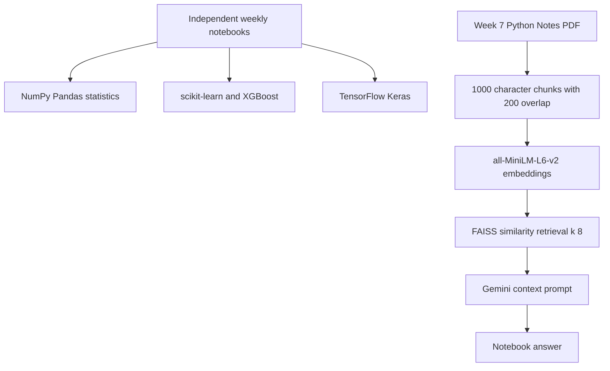

<a id="top"></a>

<div align="center">

# 📚 Celebal Internship — ML Assignments

**A week-by-week notebook collection spanning foundations, learning algorithms, and RAG.**


[Repository](https://github.com/ashishgiije/Celebal-Internship) · [Overview](#overview) · [Architecture](#architecture) · [Setup](#setup) · [Validation](#testing-and-validation) · [Audit](AUDIT_REPORT.md)

</div>

## Overview

This repository collects machine-learning internship assignments rather than one deployed application. Each week explores a different topic, from Python/statistics through supervised learning, clustering, neural networks, sequence models, autoencoders, and document question answering. Run notebooks independently with their own data and prerequisites.

## Visual preview

**Screenshot placeholder:** No verified application screenshot is supplied here. Capture a representative plot from a fresh notebook execution. No image is fabricated.

## Key features

- Week 1: Python, arrays, tables, linear algebra, statistics, probability, and inline assertions.
- Week 2: delivery-data exploration and regression experiments.
- Week 3: country-data clustering, PCA, and classification experiments.
- Week 4: TensorFlow image-classification experiments.
- Week 5: recurrent text models with SimpleRNN, LSTM, and GRU.
- Week 6: MNIST autoencoder reconstruction experiments.
- Week 7: PDF-based retrieval-augmented answering; Week 8 contains a quiz PDF.

## Technology stack

| Technology | Role in this checkout |
|---|---|
| Python + Jupyter | Assignment execution |
| NumPy + Pandas + SciPy | Numerical and statistical analysis |
| Matplotlib + Seaborn + statsmodels | Visualization and statistical diagnostics |
| scikit-learn + XGBoost | Regression, clustering, classification |
| TensorFlow / Keras | Neural networks and sequence models |
| LangChain + FAISS + Gemini | Week 7 document retrieval and generation |

## Architecture



## Application workflow

Choose a week → prepare its dependencies and data → run all cells from a clean kernel → inspect assertions, plots, and metrics. Week 7 loads the included PDF, chunks and embeds it, retrieves eight similar chunks, and prompts Gemini using the retrieved text.

## Setup

```bash
git clone https://github.com/ashishgiije/Celebal-Internship.git
cd Celebal-Internship
```

Use Python 3 with Jupyter; no repository-wide dependency manifest is provided. For the foundational notebooks:

```bash
python3 -m venv .venv
. .venv/bin/activate
pip install jupyterlab numpy pandas scipy matplotlib seaborn statsmodels scikit-learn
jupyter lab
```

For the relevant later weeks, install `tensorflow` and `xgboost` in compatible environments. GPU training is optional, not required for the basic workflow. Weeks 2 and 3 reference external `tesla_deliveries_dataset_2015_2025.csv` and `Country-data.csv`, neither included here.

Week 7 additionally imports `python-dotenv`, `langchain-community`, `langchain-text-splitters`, `langchain-google-genai`, `langchain-core`, `langchain-huggingface`, `sentence-transformers`, `faiss-cpu`, and `pypdf`. Start Jupyter in `week7_Ashish_Gije_Assignment` so `Rag/Python_Notes.pdf` resolves. Configure the Google API credential privately through the environment; do not save it into notebook cells or outputs. The configured Gemini model identifier must be available to your account.

## Project structure

```text
week1_Ashish_gije.ipynb                    # Foundations and assertions
week2_AshishGije.ipynb                     # Regression
week3_Ashish_Gije.ipynb                    # Clustering and classification
week4_Ashish_Gije_Assignment_.ipynb         # Image classification
week5_Ashish_Gije.ipynb                    # Recurrent text models
week6_Ashish_Gije.ipynb                    # Autoencoder
week7_Ashish_Gije_Assignment/              # RAG notebook and PDF
week8_Ashish_Gije Quiz.pdf                 # Quiz document
```

## Evaluation and reproducibility

Metrics are notebook-specific: regression errors/R², classifier reports, and reconstruction errors appear in code. Historical notebook outputs are not evidence of a current rerun. No aggregate accuracy is claimed. The Week 7 chain is an inference pipeline with no training or held-out answer-quality benchmark; it uses context prompting but does not implement per-user isolation, reranking, or a structured citation API.

Use Jupyter’s **Restart Kernel and Run All Cells** for a selected notebook. Export executed copies outside the checkout if automating validation. Training notebooks may download datasets or text corpora and can take substantially longer than Week 1.

## Testing and validation

Current source review and checks (4 November 2026):

Week 1: 26 nonempty code cells executed successfully, including existing assertions; other weeks unrun

Run a selected notebook from a clean kernel and inspect every assertion/error; do not count stored outputs as a fresh run.

## Limitations and roadmap

- Data files for Weeks 2 and 3 and a pinned dependency environment are missing.
- Some notebook answers diverge from assignment instructions despite weak assertions passing.
- Neural-network results require a fresh run with documented seeds and dataset splits.
- Suggested roadmap: per-week requirements, authorized data sources, CI for lightweight assertions, and reproducible experiment reports.

<details>
<summary>Troubleshooting and contributions</summary>

Check the runtime versions and working directory first. For dependency installation failures, preserve TLS and checksum verification and inspect the first error. For external services, verify your local configuration and account permissions without sharing secret values.

Before contributing, read [the audit](AUDIT_REPORT.md), reproduce the affected behavior, and keep documentation changes separate from application fixes. Add tests for changed behavior and describe remaining limitations accurately.

</details>

## Author

**Ashish Gije** · [GitHub](https://github.com/ashishgiije)

[Back to top](#top)
